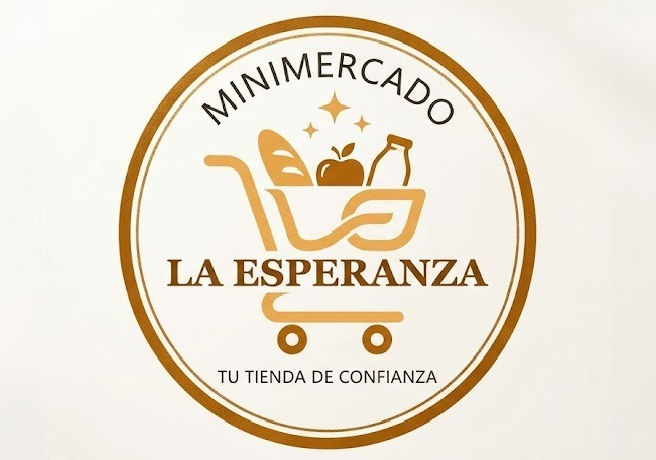
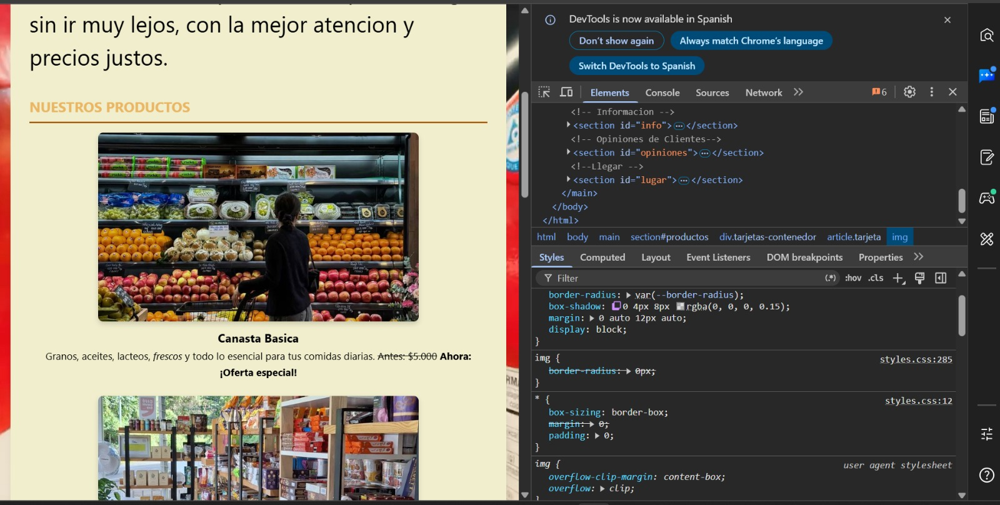
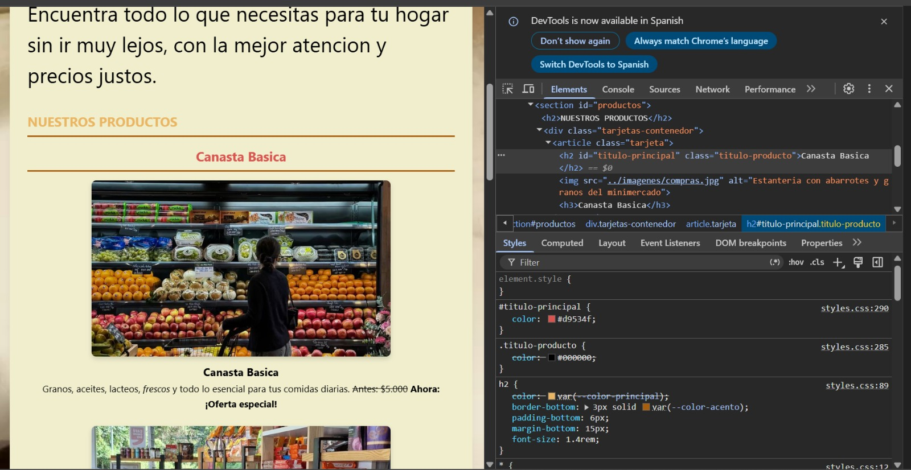
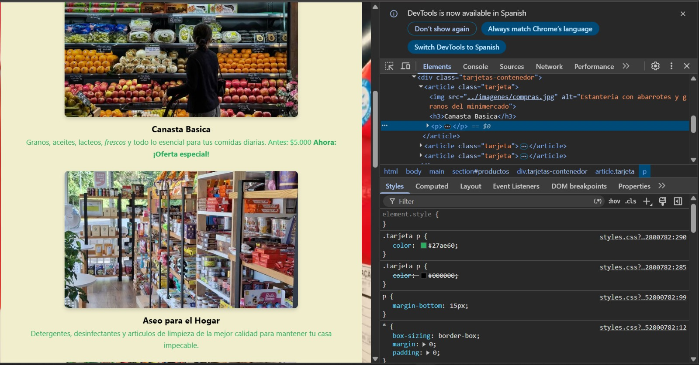
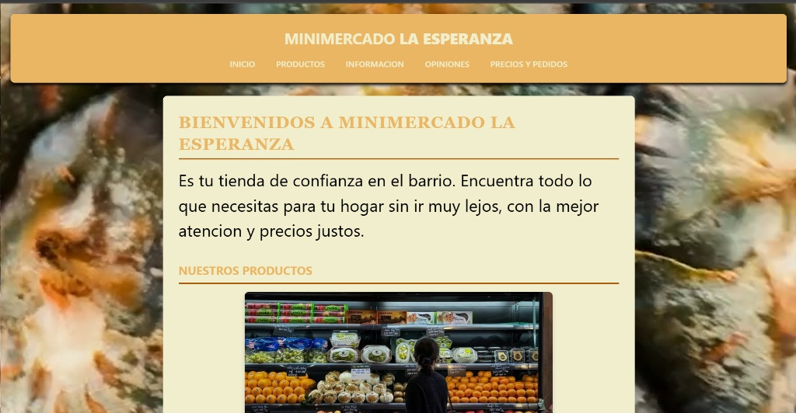
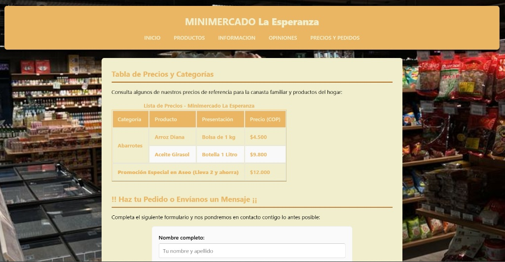
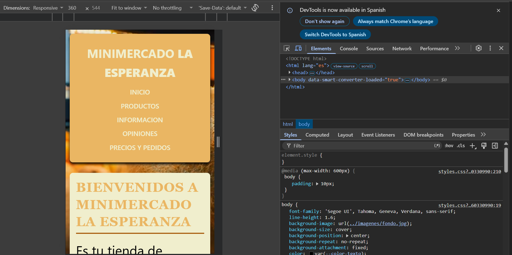

# 🛒 Micromercado LA ESPERANZA 

## 1. El proyecto
* **Negocio:** Minimercado La Esperanza.

* **Cliente / Audiencia:** Vecinos y habitantes del barrio Río de Hato en Piedecuesta, Santander.

* **Necesidad del cliente:** El minimercado realizaba sus ventas de forma presencial o mediante mensajes casuales por WhatsApp, lo que dificultaba que los clientes conocieran sus productos, precios o la ubicación exacta de manera rápida. El cliente necesitaba un sitio web sencillo, moderno y adaptado para celulares que transmitiera confianza y permitiera consultar los productos, los horarios, las opiniones de otros vecinos y realizar pedidos de forma directa.

## 2. Estructura
El proyecto está compuesto por la siguiente estructura de archivos y carpetas:

```text
minimercado-la-esperanza/
├── HTML/
│   ├── index.html
│   └── datos.html
├── CSS/
│   └── styles.css
├── imagenes/
│   ├── compras.jpg
│   ├── imagen1.jpg
│   ├── mascota.jpg
│   └── fondo.jpg
├── videos/
│   └── video1.mp4
├── capturas/
│   ├── conflicto1.png
│   ├── conflicto2.png
│   ├── conflicto3.png
└── README.md
```

## 3. Sistema visual
Para mantener una identidad limpia, cálida y coherente con una tienda de barrio, se definieron variables personalizadas en `:root` dentro de la hoja de estilos (`styles.css`):

```css
:root {
    --color-principal: rgb(234, 182, 99);   /* Tono cálido para encabezados, bordes y botones */
    --color-secundario: rgb(217, 176, 72);  /* Color de apoyo para efectos de interacción :hover */
    --color-acento: #a95e0e;               /* Color de contraste para líneas divisorias de h2 */
    --color-fondo: #e6eab7;                /* Tono suave de fondo general */
    --color-blanco: rgb(240, 238, 205);    /* Fondo claro para tarjetas y contenedores main */
    --color-texto: #000000;                /* Color neutro para máxima legibilidad del texto */
    --border-radius: 8px;                  /* Radio de borde estándar para suavizar esquinas */
}
```
## 4. Especificidad
A continuación se documentan 3 conflictos reales de especificidad calculados en la hoja de estilos (`styles.css`):

### Conflicto 1: Borde redondeado de la imagen del producto
Reglas que compiten sobre el mismo elemento ():
 * img → (0,0,1) border-radius: 0px
 * .tarjeta img (o .producto-card img) → (0,1,1) border-radius: var(--border-radius)

## Captura del conflicto 




**Analisis :** Gana .tarjeta img porque tiene 1 clase y 1 etiqueta (0,1,1) contra 0 clases y 1 etiqueta (0,0,1) de la regla general. Las clases tienen mayor peso en la especificidad que las etiquetas simples, por lo que img pierde y aparece tachada en el inspector.   


### Conflicto 2: Color del título principal del producto
Reglas que compiten sobre el mismo elemento:
* .titulo-producto → (0,1,0) color: #000000 
* #titulo-principal → (1,0,0) color: #d9534f

## Captura del conflicto



**Análisis:** Gana #titulo-principal porque los selectores de ID (1,0,0) superan jerárquicamente a los selectores por clase (0,1,0). No importa dónde estén declarados en la hoja de estilos; la regla con ID siempre prevalece y la clase .titulo-producto pierde quedando tachada.

### Conflicto 3: Color del texto descriptivo de la tarjeta (Resolución por empate/orden)
Reglas que compiten sobre el mismo elemento:
* .tarjeta p (declarada primero) → (0,1,1) color: #000000
* .tarjeta p (declarada después) → (0,1,1) color: #27ae60

## Captura del conflicto



**Análisis:** Gana la segunda regla (.tarjeta p con color: #27ae60). En este caso existe un empate exacto de especificidad (0,1,1) = (0,1,1). Ante una igualdad de condiciones, el navegador aplica el criterio de la cascada, donde la última regla declarada en el archivo styles.css sobreescribe a las anteriores y hace que la primera quede tachada.

## 5. Herencia
* **Propiedad que SÍ se hereda:** `color` y `font-family`. Se nota claramente en todo el sitio web: al definir la tipografía y el color base en el selector global `body`, todos los párrafos (`p`), listas (`li`) y textos dentro de las tarjetas heredan automáticamente la fuente `'Segoe UI'` y el color sin necesidad de escribirlos etiqueta por etiqueta.
* **Propiedad que NO se hereda:** `border` y `padding`. Esto se nota en las tarjetas o formularios: definir un borde o un relleno interno en el contenedor principal `<main>` o en un `<form>` no se transfiere de forma automática a los elementos hijos o inputs que están adentro; cada caja debe conservar o definir sus propias propiedades de borde y espacio de manera independiente.

---

## 6. Modelo de cajas
### Cálculo del ancho total de un componente (`form`)
Para el formulario de pedidos ubicado en `datos.html`:
* Ancho máximo asignado (`max-width`): `600px`
* Relleno interno (`padding`): `20px` a cada lado (`40px` en total horizontal)
* Borde (`border`): `1px` a cada lado (`2px` en total horizontal)
* Propiedad global aplicada: `box-sizing: border-box;`

**Cálculo:** Debido a que utilizamos `box-sizing: border-box`, el ancho total visible del componente se ajusta rígidamente al límite de **`600px`**. El navegador calcula el `padding` y el `border` hacia adentro de ese espacio, dejando un área útil interna de `558px` para los campos sin desbordar el contenedor.

## 7. Selectores
Se hizo uso de pseudoclases estructurales en la tabla de precios (`datos.html`):
```css
tbody tr:nth-child(even) {
    background-color: #f9f9f9;
}
```
Funcionamiento: Esta regla selecciona las filas (<tr>) del cuerpo de la tabla (<tbody>). Cuenta a los elementos hermanos de forma sucesiva y aplica el color de fondo gris claro únicamente a las filas de posición par (2, 4, 6, etc.), logrando un efecto visual de listas alternadas que facilita enormemente la lectura de los productos y precios.


## 8. Responsive
Se implementó una consulta de medios (@media) orientada a dispositivos móviles pequeños de hasta 360px de ancho:
```css
@media (max-width: 600px) {
    body {
        padding: 10px;
    }
    main {
        padding: 15px;
    }
    nav ul {
        flex-direction: column;
        align-items: center;
        gap: 8px;
    }
    table, th, td {
        font-size: 0.85rem;
        padding: 8px 10px;
    }
}
```
 
En pantallas reducidas de celulares (360px), los elementos en línea de la barra de navegación se saldrían de la pantalla horizontalmente. Cambiar nav ul a flex-direction: column apila los enlaces verticalmente y reduce el tamaño de los textos y márgenes de las tablas, garantizando una lectura cómoda sin desbordes.


## 9. Problemas y soluciones
Error de sintaxis en las transiciones de los botones:

* Problema: Al intentar dar animación de color a los botones, no funcionaba porque se escribió por error una coma decimal (0,3s) en lugar de un punto (0.3s).

* Solución: Se ajustó la sintaxis a transition: background-color 0.3s ease;, logrando que la transición respondiera perfectamente al pasar el cursor.

Desbordamiento de imágenes de productos en móvil:

* Problema: Las imágenes de las tarjetas de presentación se salían del contenedor en las pantallas de 360px de ancho.

* Solución: Se agregaron las propiedades de adaptación width: 70%, max-width: 100% y object-fit: cover en las reglas de la clase .tarjeta img, permitiendo que se ajustaran de manera fluida al tamaño de la pantalla.

## 10. Capturas 

Escritorio 





360px de ancho 


